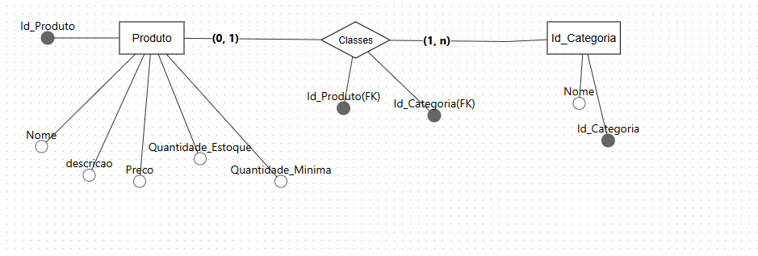

# Organiza Comercial 



## Tecnologias utilizadas

- Node.js
- Express
- MySQL
- JavaScript
- dotenv

## Funcionalidades

- Cadastro de produtos.
- Consulta de produtos.
- Atualização de produtos.
- Exclusão de produtos.
- Cadastro e consulta de categorias.
- Relacionamento entre produtos e categorias.
- Controle das informações das mercadorias.

## Banco de dados

O banco de dados utiliza as tabelas:

- `produtos`: armazena as informações dos produtos.
- `categorias`: armazena as categorias disponíveis.
- `classes`: realiza o relacionamento entre produtos e categorias, conforme o modelo do banco de dados.

## Como executar o projeto

1. Clone o repositório.
2. Entre na pasta do backend.
3. Instale as dependências:

   ```bash
   npm install
   ```
   npm init -y
   npm install express
   npm install mysql2
   npm install dotenv


4. Configure as variáveis de ambiente no arquivo `.env`:

   ```env
   API_PORT=3300
   DB_HOST=localhost
   DB_USER=root
   DB_PASSWORD=sua_senha
   DB_NAME=organiza_comercial
   ```

5. Execute o servidor:

   ```bash
   npm run dev
   ```

6. Acesse a API pelo endereço:

   `http://localhost:3300`

7. Rotas da API 
 categoria:
 router.get("/categoria", categoriaController.buscarTodos);
 router.get("/categoria/:id", categoriaController.buscarPorId);
 router.post("/categoria", categoriaController.criar);
 router.put("/categoria/:id", categoriaController.atualizar);
 router.delete("/categoria/:id", categoriaController.excluir);

 Produtos: 
 router.get("/produtos", produtosControllers.buscarTodos);
 router.get("/produtos/:id", produtosControllers.buscarPorId);
 router.post("/produtos", produtosControllers.criar);
 router.put("/produtos/:id", produtosControllers.atualizar);
 router.delete("/produtos/:id", produtosControllers.excluir);
 